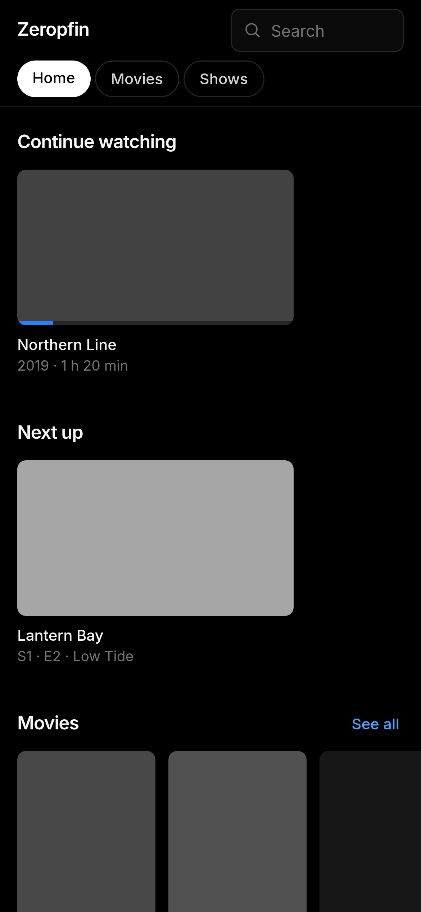
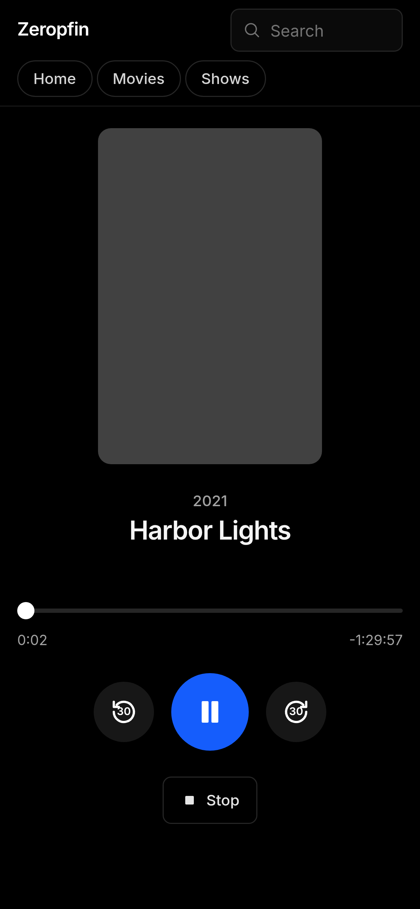
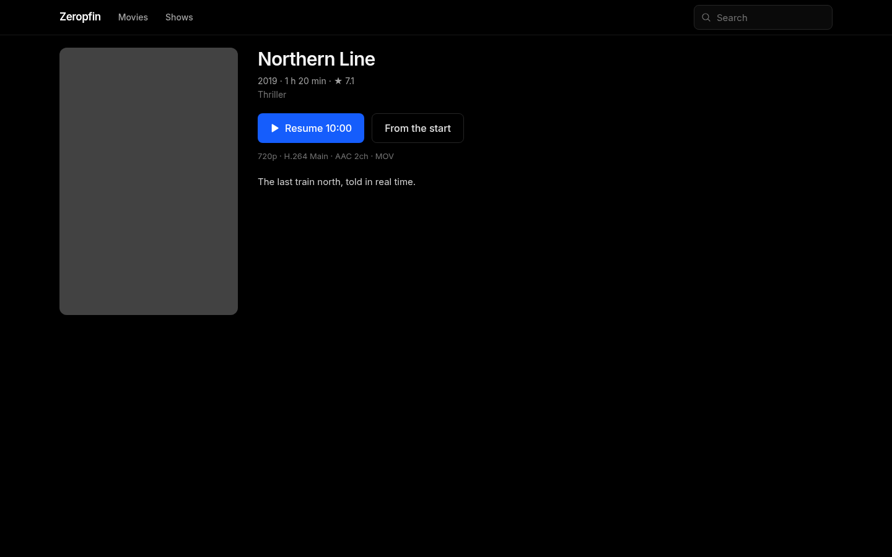

# Zeropfin

A tiny Jellyfin playback receiver for the original **Raspberry Pi 1 Model B (256 MiB)** and
**Raspberry Pi Zero / Zero W**, driving a composite CRT through
[ZeroPlay](https://github.com/HorseyofCoursey/zeroplay). Your phone is the remote: open the Pi's
web page in Safari, browse your Jellyfin library, and the Pi fetches and plays the video itself.
The phone never carries the stream.

| iPhone — Home | Now Playing | Details (desktop) |
|---|---|---|
|  |  |  |

Screenshots come from the end-to-end test against the fake Jellyfin (gray placeholder artwork).

> **Status — MVP, not yet validated on hardware.** All automated tests run on x86_64 with a mock
> player and a fake Jellyfin; the ARMv6 build is produced and unit-tested under qemu emulating an
> ARM1176 CPU. Nothing has run on a real Pi yet; see
> [docs/hardware-test-report.md](docs/hardware-test-report.md).

## What it does
- Native C11 daemon (`zeropfin`, 132 KiB stripped on ARMv6), libmicrohttpd + libcurl + cJSON. No Node, Python or
  browser on the Pi.
- Supervises one `zeroplay --control` child: play, pause, resume, seek, stop; crash recovery;
  a crash never counts as "watched".
- Jellyfin 10.10+ client: libraries, search, continue watching, next up, latest, series/seasons/
  episodes, artwork, resume points, and playback reporting (start/progress/stop, marks played at EOF).
- **Direct play only, honestly:** H.264 8-bit (Baseline/Main/High, ≤ level 4.1, ≤ 1080p30,
  ≤ 12 Mbps) in MP4/MOV/MKV with AAC/MP3/AC3/FLAC/Opus as the **first** audio track. Everything else
  is refused with the exact reason. No transcoding (yet).
- Loopback **media relay**: ZeroPlay plays `http://127.0.0.1:…/media/<random>`, and the daemon adds
  the Jellyfin authorization header. Tokens never appear in URLs, argv, logs or the browser.
- Position is **verified** with the ZeroPlay fork's `status` extension, otherwise labelled
  **estimated**.
- Mobile-first remote: Vite + Tailwind v4 + Alpine (CSP build), self-hosted Inter, black/white/gray
  with blue as the only accent, no gradients. 33.5 KiB of gzipped JS+CSS.
- Pairing with one-time codes (shown on the TV or printed over SSH), HttpOnly session cookies,
  CSRF/Origin/Host checks, LAN-only by default.

## Quick start (Raspberry Pi OS Lite 32-bit Trixie, display already working)
Download `zeropfin-<version>-armhf.zip` from the
[releases](https://github.com/tecncr/zeropfin/releases). It holds a `.deb` with the ARMv6 binaries
(including a patched ZeroPlay) and a setup script; apt fetches the runtime libraries. Nothing is
compiled on the Pi.
```sh
unzip zeropfin-<version>-armhf.zip && cd zeropfin-<version>
sudo ./setup.sh                      # apt-get install ./zeropfin_<version>_armhf.deb
sudo -u zeropfin zeropfin setup        # Jellyfin URL + account; stores only a token
```
Then open `http://<pi>.local:8080/` in Safari and pair (**Show code on TV**, or
`sudo -u zeropfin zeropfin pair`). Details: [docs/deployment.md](docs/deployment.md).

## Build from source (developer machine)
Requirements: CMake ≥ 3.25, a C11 compiler, `libmicrohttpd`, `libcurl` and `cJSON` dev packages;
Node ≥ 22 with pnpm for the web UI; podman (or docker) with qemu-user binfmt for the ARMv6 build.
```sh
cmake -S . -B build -G Ninja && cmake --build build && ctest --test-dir build --output-on-failure
(cd web && pnpm install --frozen-lockfile && pnpm test && pnpm build && pnpm check:design)
python3 scripts/dev-stack.py         # full stack with mocks: prints URL + pairing code
scripts/build-armv6.sh --test --zeroplay ../zeroplay --package --install-test
                                     # Raspbian Trixie armhf build, all tests on emulated ARM1176, .deb
scripts/package.sh                   # dist/zeropfin-<version>-armhf.zip + content checks
```
See [docs/testing.md](docs/testing.md).

## Media constraints
ZeroPlay always plays the first H.264 video, the first audio track and the first embedded
subtitle track (text subtitles are shown automatically). Audio-track selection, external
subtitles, HEVC/AV1/VP9, 10-bit H.264, live TV and HLS are not supported. Large 1080p files are
limited by the Pi 1's 100 Mbit Ethernet / USB bus; measure on your hardware.

## Security notes
LAN appliance: never expose it to the Internet. Plain HTTP on the LAN means Wi-Fi sniffers could
steal a session cookie; use WPA2/3 or a TLS reverse proxy. See [docs/security.md](docs/security.md).

## Docs
[Architecture](docs/architecture.md) · [API](docs/api.md) · [Security](docs/security.md) ·
[Deployment](docs/deployment.md) · [Testing](docs/testing.md) · [Hardware](docs/hardware.md) ·
[Hardware test report](docs/hardware-test-report.md) · [Plan](docs/implementation-plan.md) ·
[ADRs](docs/adr/)

## License
MIT; see [LICENSE](LICENSE). Third-party components: [THIRD_PARTY_LICENSES.md](THIRD_PARTY_LICENSES.md).

Repository: https://github.com/tecncr/zeropfin
